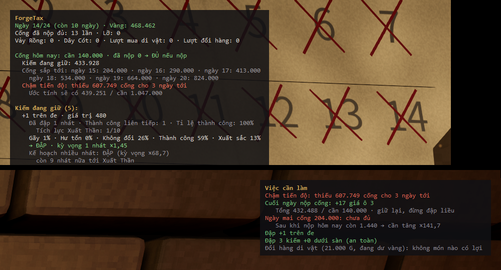

# ForgeSeer

[](https://github.com/tranhoangtu-it/forgeseer/releases/latest)
[](LICENSE)

A small overlay I wrote for ForgeTax. It sits on top of the game and shows the real odds of your
next hammer strike, plus what I'd do next: strike or stop, which swords to offer for the tribute,
which relic is worth buying.



## Why

I kept breaking swords at +14 and offering the wrong ones at the end of the day. The game knows
the exact odds for every strike (they change with every relic you pick up), it just doesn't show
them. So I attached to the game, called its own odds function and put the numbers on screen.
Then I kept adding the things I was working out on paper anyway.

## What it shows

- Odds for the next strike on every sword: break, damage, no change, success, great success,
  computed by the game itself with all your relics applied.
- Strike or stop. One-strike expected value, and a multi-strike plan that knows about Frenzy and
  how many strikes you actually land during one (it measures that as you play).
- Tribute: what's due today, the next few days, whether you're on pace, and which swords to offer
  so you give up the least.
- Relics: what buying, dropping or swapping each one would do to your odds, and a list of the
  relics that cut the break chance the most at +8 / +12 / +16.
- Ghost merchant offers rated against their price.
- A "to do" panel on the right with the next steps in order.
- F7 opens a legend that explains every term.

The overlay uses the same language as the game. Supported: English, 한국어, 日本語, 简体中文,
繁體中文, Deutsch, Español, Português (Brasil), Русский, Tiếng Việt. Game terms (outcome names,
Frenzy, relics, tribute...) use the game's own translations where they exist.

The settings window (F6) has two more tabs. Simulation plays the rest of your current run a couple
of thousand times with the game's odds and shows how likely you are to still be alive each day
with a few ways of playing: following the overlay, careful, bold, safe strikes only. Stats sums up
the runs you've finished: how far you got, where the lost ones ended, your best grade over time.
It also tells you when a new version is out (one quick check on GitHub at start-up, you can turn
it off).

## Install

1. Grab `ForgeSeer-<version>-windows.zip` from [Releases](https://github.com/tranhoangtu-it/forgeseer/releases/latest) and unzip it.
2. Run ForgeTax in windowed or borderless mode. The overlay can't draw over exclusive fullscreen.
3. Start `ForgeSeer.exe`. A small settings window opens first: language, opacity, font size,
   which panels to show, live reading on or off. Press Start and it drops to the taskbar while
   the overlay takes over. It finds the game on its own.

Click the ForgeSeer icon on the taskbar (or press F6) to bring the settings back mid-game; changes
show up on the overlay right away. Closing that window with X just minimizes it again. If you
don't want to see it at every launch, tick "Skip this screen next time" (F6 still opens it).

| Key | |
|---|---|
| F6 | settings |
| F7 | legend on/off |
| F8 | hide/show |
| F9 | drag to move, press again to lock (position is remembered) |
| F10 | quit |

### From source

```bash
pip install frida
python -m forgeseer             # overlay
python -m forgeseer --no-live   # read the save file only
python -m forgeseer --once      # print the state to the console
python -m forgeseer --lang de   # pick a language instead of following the game
python -m forgeseer --no-settings  # skip the settings window, go straight to the overlay
```

## How it works

ForgeSeer uses [Frida](https://frida.re) to attach to `ForgeTax.exe` and calls the game's own
read-only functions on its main thread about three times a second (save snapshot, odds). Relic
"what if" checks run on a copy of the campaign, never the real one. If it can't attach, it falls
back to reading the save file. More detail in [docs/technical-notes.md](docs/technical-notes.md).

## Please read

- It only reads. It doesn't change odds, saves or results, and it doesn't try to predict the RNG.
  This is an unofficial fan tool, not affiliated with the ForgeTax developers.
- ForgeTax has online leaderboards. ForgeSeer doesn't change outcomes, but decide for yourself
  whether you're comfortable using a helper there.
- Antivirus software may flag it because Frida attaches to another process. The source is all
  here if you'd rather build it yourself.
- A game update can break live reading until I catch up. The save-file mode keeps working.

## Tiếng Việt

ForgeSeer là overlay mình viết cho ForgeTax: hiện tỉ lệ thật của nhát búa kế tiếp (lấy từ chính
hàm của game, đã tính mọi di vật), gợi ý đập hay dừng, chọn kiếm nộp cống, di vật nào đáng mua.
Overlay tự đổi theo ngôn ngữ đang chọn trong game, tiếng Việt dùng đúng thuật ngữ của bản dịch
chính thức.

Cách dùng: tải bản zip ở [Releases](https://github.com/tranhoangtu-it/forgeseer/releases/latest),
mở game ở chế độ cửa sổ hoặc không viền, rồi chạy `ForgeSeer.exe`. Màn hình cài đặt hiện ra trước (ngôn ngữ, độ đậm,
cỡ chữ, khung nào hiện, bật/tắt đọc trực tiếp); bấm Bắt đầu là nó thu xuống taskbar, chỉ còn
overlay. Bấm biểu tượng trên taskbar hoặc F6 để mở lại. F7 chú giải, F8 ẩn, F9 di chuyển, F10
thoát. Công cụ chỉ đọc, không sửa gì trong game; phần mềm diệt virus có thể cảnh báo
vì Frida gắn vào tiến trình game.

## Contributing

Bug reports and ideas are welcome, see [CONTRIBUTING.md](CONTRIBUTING.md). Changes are listed in
[CHANGELOG.md](CHANGELOG.md).

## License

[MIT](LICENSE)
